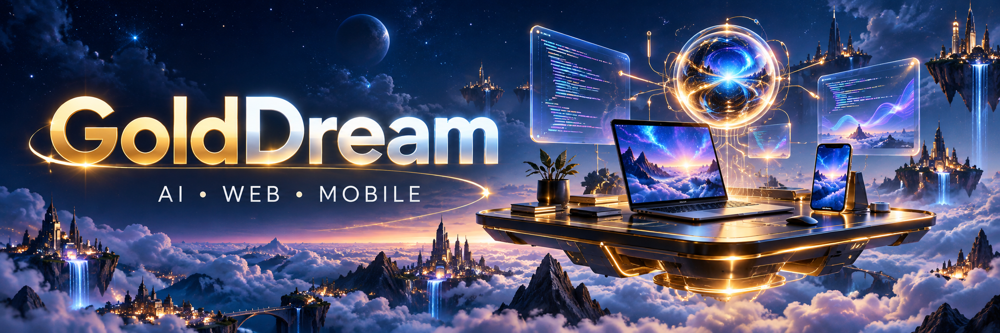

  

<h1 align="center">Hey there, I'm GoldDream 👋</h1>
<h3 align="center">🤖 AI & Full-Stack Developer · 📱 Mobile App Builder</h3>

Turning ambitious ideas into thoughtful digital experiences.

  
  
  

---

## ✨ A little about me

I work across **AI, full-stack web development, and cross-platform mobile apps**, connecting polished interfaces with the backend services that make them useful.

- 🧠 **AI with a purpose** — assistants, RAG workflows, and practical automation.
- 🌐 **Products from end to end** — interfaces, APIs, databases, and cloud delivery.
- 📱 **Mobile experiences** — Flutter and React Native applications for iOS and Android.
- ⚡ **Fast starts, thoughtful foundations** — focused MVPs that can evolve with the product.
- 🛠️ **Care in the details** — critical-flow testing, clear documentation, and maintainable code.

> 💡 My approach: understand the problem, build the core experience, and improve through feedback.

## 🚀 What I build

<table>
<tr>
<td width="33%" valign="top">
<h3>🤖 AI & Automation</h3>

LLM integrations, AI assistants, retrieval workflows, and computer vision features.

Python · OpenAI APIs · RAG · OpenCV
</td>
<td width="33%" valign="top">
<h3>🌐 Web & SaaS</h3>

Web platforms, dashboards, customer portals, and connected backend services.

React · Next.js · Node.js · PostgreSQL
</td>
<td width="33%" valign="top">
<h3>📱 Mobile Apps</h3>

Cross-platform apps with authentication, payments, notifications, and API integrations.

Flutter · React Native · Expo · Firebase
</td>
</tr>
</table>

## 🧰 My toolkit

### 🎨 Frontend & mobile

  

### ⚙️ Backend & data

  

### ☁️ Cloud & delivery

  

**🧠 AI & vision:** OpenAI APIs · RAG · OpenCV · YOLO  
**⚡ Rapid prototyping:** FlutterFlow · Lovable · Bubble

<b>🔎 Behind the build — how I approach projects</b>

 

1. 🎯 **Understand** the users, constraints, and essential workflows.
2. 🧩 **Design** the interface, API boundaries, and data model together.
3. 🛠️ **Build** in focused increments with visible progress.
4. 🧪 **Verify** authentication, payments, integrations, and failure handling.
5. 🚢 **Deliver** with clear setup instructions and a practical handoff.

## 🪄 Explore my work

Code, experiments, and product ideas live in my [public repositories →](https://github.com/golddream0129-ux?tab=repositories)

<!-- Add 2–3 verified projects here when ready. Include your role, the problem
solved, the stack, and a working demo or repository link. Add a professional
contact link only after choosing the address you want to share publicly. -->

---

  <b>✨ Thoughtful interfaces. Practical AI. Maintainable software.</b> 
  Thanks for stopping by — take a look around 👋

